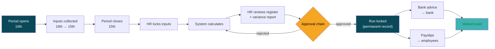
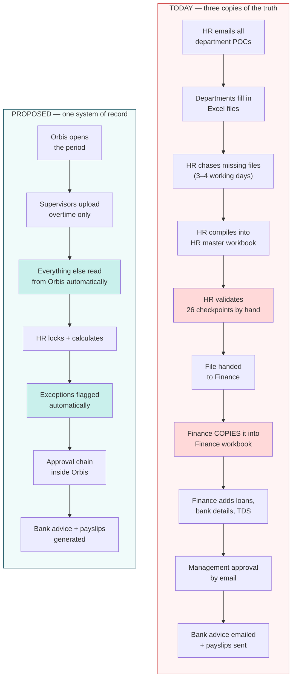
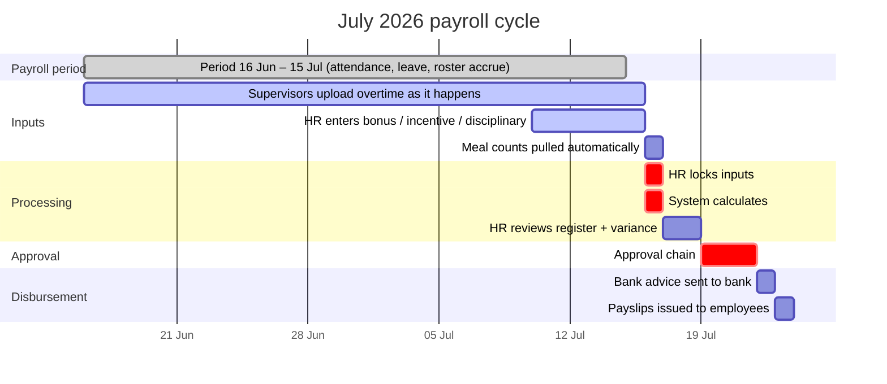
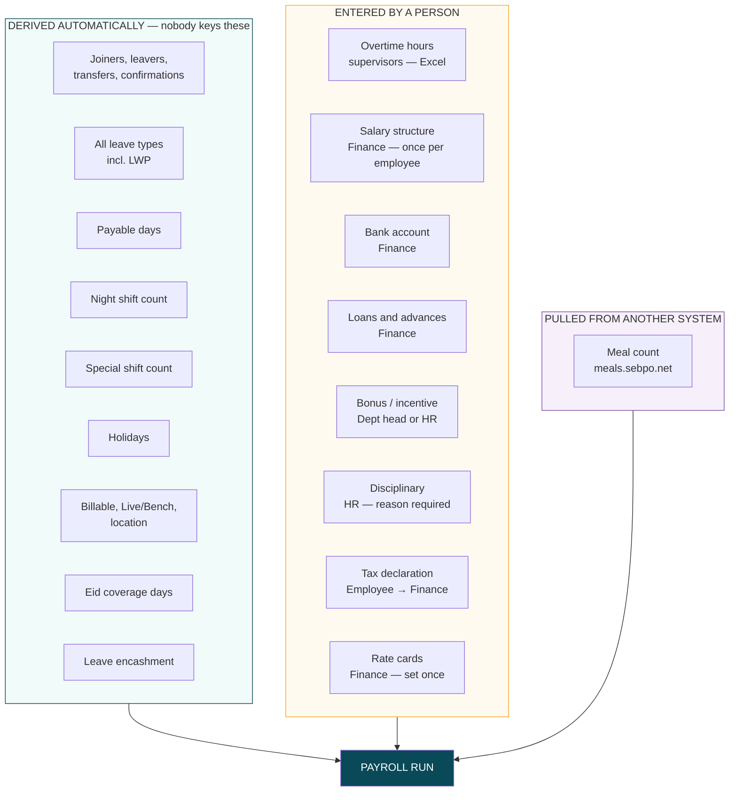
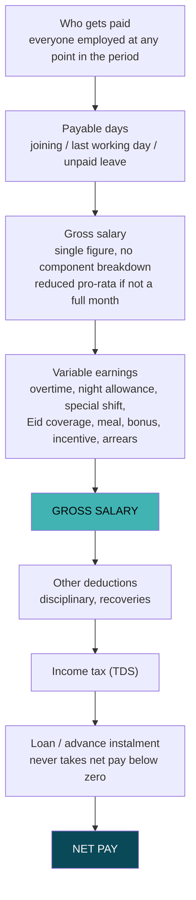
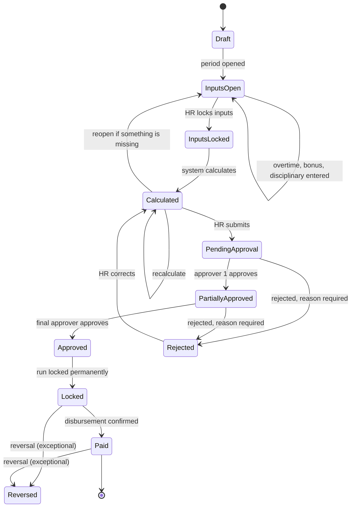
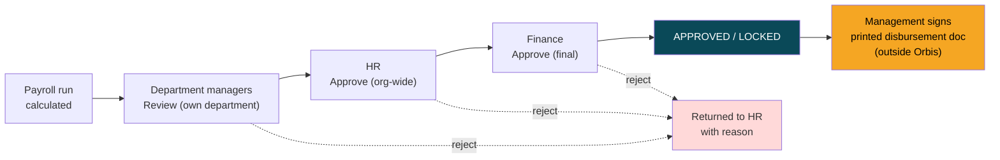
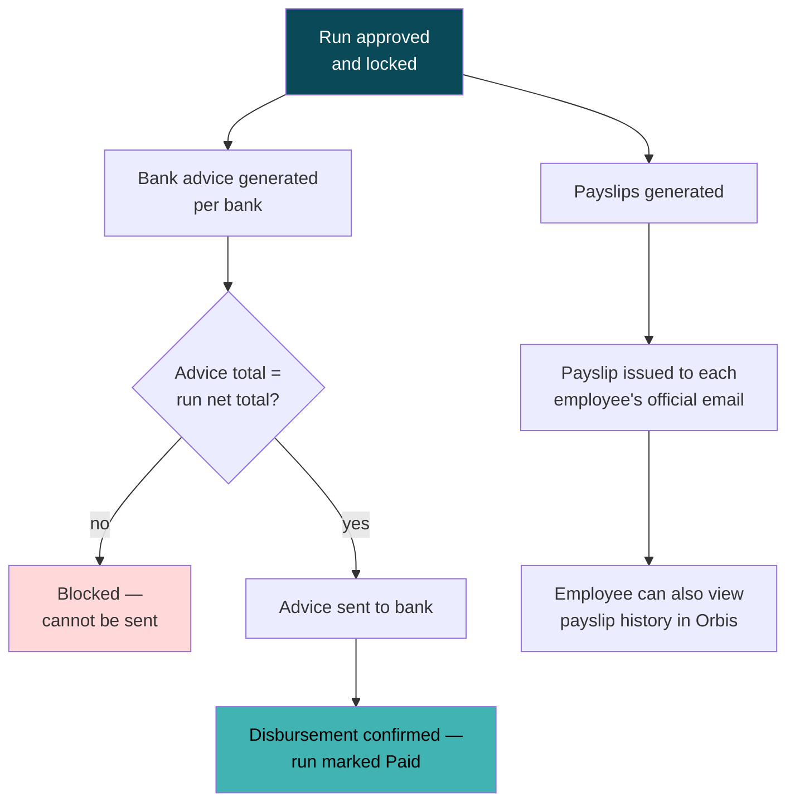
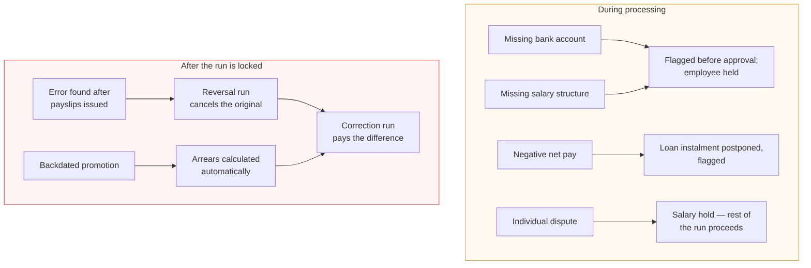

# Payroll in Orbis — Process Design

**For review and approval by the Head of HR and the Head of Finance.**

| | |
|---|---|
| **Version** | Draft 1.2 |
| **Date** | 2026-08-06 (updated 2026-08-11 after the HR/Finance decisions meeting; updated 2026-08-13 after reviewing HR's and Finance's actual working templates; updated 2026-08-20 after reviewing July 2026's actual filled-in HR payroll master compilation; updated 2026-08-24 after Finance provided their actual tax computation template; updated 2026-09-07 after AdOps (Digital Advertising) supplied a night-shift/OT/transport rate workbook and a new Dedicated Night Shift concept) |
| **Prepared by** | Software Development Team |
| **Source documents** | *HR Payroll Compilation Process* (HR Operations SOP), *Finance Salary SOP*, *HR Payroll File Template.xlsx*, *Finance Monthly_Salary_Template.xlsm*, *Monthly_Salary_Template_Reporting.xlsm*, *Master Sheet_July_2026.xlsx* (HR's actual July 2026 payroll compilation), *Tax Calculation.xlsx* (Finance's per-employee ITA-2023 salary tax computation template), *AdOps Payroll Rates.xlsx* (Digital Advertising's night-shift/OT/transport rate workbook) |
| **Status** | Awaiting formal sign-off (§14). Most open decisions in §12 were locked at the 2026-08-11 meeting; the 2026-08-13 template review, the 2026-08-20 master-sheet review, the 2026-08-24 tax-calculation review and the 2026-09-07 AdOps policy review reopened a few of them and raised new ones — see §12. **Phase 1 (compensation master), Phase 2 (rate tables + input pipeline), Phase 3 (calculation engine + register, no approval chain) and Phase 4 (in-house TDS calculation) implementation started 2026-08-20/2026-08-24, ahead of formal sign-off, by explicit decision** — the approval chain, payslips/bank advice, loans/settlement and everything downstream (Phase 5+) still waits for sign-off and for the remaining open questions in §12. The AdOps night-shift/OT/transport-allowance work (§12, questions 43–46) is **implemented** — see `PAYROLL_PLAN.md`'s 2026-09-07 dated section. |

---

## 1. Why we are changing

Payroll today runs on two separate Excel workbooks and a chain of emails.

- **HR Operations** emails every departmental Payroll POC on the 15th/16th, waits 3–4 working days for files, then compiles them into an HR master workbook and runs a 26-point manual validation.
- **Finance** then takes HR's file and **copies it into a second workbook** (Finance SOP steps 2, 3, 4 and 6 are all "copy the latest data across and verify"), before adding loans, bank accounts, TDS and the bank advice.

Meanwhile Orbis already holds — accurately, and updated daily — the employee master, the roster, all leave, joining and last-working dates, departments, teams, designations, work locations and billing status.

So the same information exists in **three** places and is reconciled by hand every month. Most of the validation effort in both SOPs is not checking payroll correctness; it is checking that the three copies still agree.

**What we are proposing:** one payroll process inside Orbis that reads the data it already owns, asks people only for what it genuinely cannot know, calculates salary, routes it for approval, and produces the bank advice and payslips.

### What changes for each team

| Team | Today | After |
|---|---|---|
| **Department supervisors** | Fill in and email a payroll Excel file every month | Upload **one overtime sheet**. Nothing else. |
| **HR Operations** | Chase files, compile a master, validate 26 points by hand | Review a pre-built register with exceptions already flagged |
| **Finance** | Re-key HR's file into a second workbook, then calculate | Open the same run HR prepared, review, approve |
| **Employees** | Receive a payslip by email | Same, plus a permanent payslip history in Orbis |
| **Management** | Approve by email | Approve in Orbis, with the approval permanently recorded |

---

## 2. What Orbis already knows

This is the most important table in this document. **Every row here is information departments currently supply by email that they will no longer need to supply.**

| Information | Where Orbis already holds it |
|---|---|
| New joiners | Employee record — joining date |
| Leavers and last working day | Employee record + Offboarding module |
| Final settlement completed | Offboarding case status |
| Department / team transfers | Employee record |
| Confirmation status and date | Employee record |
| Promotions and designation changes | Employee record |
| Casual, Sick, Annual, Maternity, Compensatory leave | Leave module + Roster |
| Leave Without Pay (LWP) | Leave module — marked as unpaid leave |
| Half-day leave | Leave module |
| Payable days | Calculated from joining date, last working day and unpaid leave |
| Night shift count | Roster — count of night shifts worked |
| Special / custom / quarterly shift count | Roster |
| Government and festival holidays | Holiday calendar |
| Billable / Non-billable | Employee job information |
| Live / Bench / Trainee | Employee job information |
| Workstation (MHK, RAOWA, MBD, JHP) | Employee record |
| WFO / WFH / Hybrid | Employee record |
| Leave encashment | Leave module — encashment requests |

### What Orbis still needs from people

| Information | Who provides it | How |
|---|---|---|
| **Overtime hours** | Department supervisors | Excel upload — date, employee ID, OT type, hours |
| **Salary structure** | Finance / HR | Entered once per employee; updated on increment or promotion |
| **Bank account details** | Finance | Entered once per employee; updated on change |
| **Salary loans** | HR records the approved file note; Finance (Payroll Admins) marks it disbursed | Deducted automatically from the first deduction payroll until the balance is zero (`/payroll/loans/`, 2026-10-08). Salary advances are not practised. |
| **Performance bonus / incentive** | Department head or HR | Excel upload **or** single entry |
| **Disciplinary adjustments** | HR (Legal) | Single entry with mandatory reason |
| **Tax category** (Men / Women & Senior Citizen / Disabled & 3rd gender / Freedom Fighter / Parents of disabled child) | HR / Finance | Entered once per employee, updated if it changes. **Confirmed 2026-08-24** — TDS is now calculated in-system every period from gross salary + this category + the investment declaration below; Finance no longer uploads a monthly TDS Excel (superseded, question 1, §12). |
| **Annual investment declaration** (savings certificate, life insurance premium, DPS, share market, retirement fund contribution) | Employee, reviewed by Finance | Entered once per tax year (Jul–Jun), updated if it changes. Feeds the tax rebate calculation — defaults to zero investment (no rebate beyond the income-based term) until declared. |
| **Rates** (OT, night, Eid) | Finance / HR | Configured once, updated when rates change. Overtime basis (exact-second vs. flat-per-day) is configured per department, not per overtime type (locked 2026-08-11). |
| **Meal deduction rate** | Finance | Tiered by the employee's own gross salary, configured once, updated when bands change (locked 2026-08-11) |
| **Eid coverage parameters** | Management approval | Coverage dates and rates entered per Eid; eligible days derived from roster |
| **Meal count** | *(automatic)* | Pulled from meals.sebpo.net |

---

## 3. Overview of the new process



Once a run is **locked**, it can never be edited. This is deliberate — a payslip issued to an employee and a file sent to the bank must remain exactly as they were. Corrections are made by a separate correction run (see §9).

---

## 4. Today vs. proposed



The two red boxes are the steps that change structurally: **manual duplicate-checking is replaced by automated validation, exception review and reconciliation reports**, and **Finance re-keying HR's file disappears** because there is only one controlled payroll run.

---

## 5. Monthly timeline

The payroll period runs **16th of the previous month → 15th of the current month**, named after the current month. July payroll covers 16 June – 15 July.



Compared with today, the input-collection window is no longer a bottleneck: supervisors upload overtime **as it happens** through the month rather than scrambling in a 3–4 day window after an email.

---

## 6. Payroll control framework

The goal is not only to automate payroll. The goal is to replace spreadsheet control with system control.

| Control | How Orbis will enforce it |
|---|---|
| **Single source of truth** | Employee, roster, leave and offboarding data are read directly from their owning modules; payroll stores only a locked snapshot of what was used. |
| **Segregation of duties** | Salary and bank access are governed by payroll-specific permissions, not general HR profile access. The person who uploads or edits an input should not be the only approver of the final run. |
| **Maker-checker approvals** | Payroll runs move through a configurable approval chain. Every approval, rejection and reason is permanently recorded. |
| **Exception-based review** | HR and Finance review flagged exceptions and variances instead of manually checking every copied field in a workbook. |
| **Immutable output** | Once a run is locked, payslips and bank advice are never edited. Corrections use reversal, supplementary or final-settlement runs. |
| **Audit trail** | Uploads, corrections, calculations, approvals, bank advice generation, payslip release and paid confirmation all create audit events. |
| **Controlled exports** | Payroll register, bank advice and GL/cost-centre exports are generated from the locked run and should be downloadable only by authorised payroll/finance users. |

### Operating roles

| Activity | Primary owner | Checker / approver |
|---|---|---|
| Salary structure setup and revision | HR / Finance payroll owner | Payroll approver |
| Bank account setup and verification | Finance | Finance approver |
| Overtime upload | Department supervisor | HR review through exception report |
| Bonus / incentive input | Department head or HR | Payroll approver |
| Disciplinary adjustment | HR / Legal | Payroll approver |
| Tax category & investment declaration entry | Employee / HR / Finance | Finance review through exception report |
| TDS calculation | *(automatic)* | Finance reviews the computed figure through the register/variance report |
| Payroll calculation | Payroll admin | HR + Finance reviewers |
| Payroll run review (per department) | Department approving manager | "Reviewed" sign-off, own department's employees only |
| Payroll run approval (org-wide) | HR authorised users | — |
| Final payroll approval | Finance | — |
| Bank advice release | Finance | Final payroll approver |
| Payslip release | Payroll admin / system | Locked approved run |
| Paid confirmation | Finance | Audit trail |
| Disbursement authorisation | Management | Signed on the printed bank advice; **the scanned signed copy is then uploaded into Orbis (confirmed 2026-08-13)** |

> **Locked 2026-08-11:** the approval chain is Department Review (own department) → HR Approval (org-wide) → Finance Approval (final). Management's disbursement sign-off happens on a printed document, and a scanned copy is uploaded into Orbis afterward (confirmed 2026-08-13). **Confirmed 2026-08-13:** no preparer (of salary, bank or variable-pay inputs) is blocked from approving the same run at any of these stages — Finance's approval is the only real finalisation gate.

### Payroll calendar and cut-off rules

The monthly calendar should be published in Orbis for each period.

| Event | Normal timing | Rule |
|---|---|---|
| Period opens | 16th | OT and variable inputs may be uploaded from this date. |
| Period closes | 15th | Roster, leave, LWP and attendance-derived inputs stop accruing for the period. |
| Input lock | 16th or next working day | Late inputs are blocked from the regular run unless HR reopens inputs. |
| Overtime floor | While a period's run is open | **Enforced in Orbis since 2026-09-15.** Overtime can only be filed for dates on or after the open period's start — no backfilling into a period that has already moved on. Working *past* the open period's end is always fine: on Sep 18, with Aug 16 – Sep 15 still being compiled, a supervisor files Sep 17 normally and it lands in the next period. Future-dated overtime is rejected outright. |
| Overtime after lock | From input lock | **Enforced in Orbis since 2026-09-15.** Once a period's inputs are locked, only HR-Payroll (and Payroll Admins) can add, edit, approve, void or delete its overtime — supervisors are read-only for that period and keep working normally in the open one. Reopening the run hands it back to them automatically. |
| HR review | After calculation | Exceptions and variance must be cleared, explained or held. |
| Finance review | After HR review | Bank, tax, loan, deductions and totals are checked. |
| Final approval | Before bank advice | No bank advice or payslip can be issued before approval. |
| Paid confirmation | After bank disbursement | Finance marks the run paid and records the payment reference. |

Late overtime, bonus, bank changes, leave corrections or resignation updates discovered after input lock should not be inserted silently. They must either trigger an explicit reopen before approval, or move to a supplementary/correction run after the regular run is locked.

### Pre-payroll checklist

Before HR submits a run for approval, Orbis should show at least these checks:

- Missing approved salary structure.
- Missing or unverified bank account.
- New joiner with no salary structure.
- Leaver / LWD case requiring final settlement review.
- Employee on salary hold.
- LWP, half-day or unpaid absence affecting payable days.
- Unapproved or unresolved leave inside the period.
- Excessive overtime or duplicate overtime upload.
- Zero net pay, negative net pay, or postponed loan instalment.
- Large net-pay variance against the previous month.
- Missing tax category for an included employee (TDS can't be calculated without one).

### Post-payroll checklist

Before a run is marked paid, Finance should be able to verify:

- Bank advice total equals the approved net payable total.
- Bank advice employee count equals the payable employee count excluding held rows.
- Payslip count equals employees included in the locked run.
- Held employees are excluded from payment and carried to the next appropriate run.
- GL / cost-centre summary has been exported or reviewed if required.
- Any failed payslip email or PDF generation has a visible retry/error status.

---

## 7. Where every input comes from



**Overtime upload format.** Supervisors upload a sheet with four columns:

| Working date | Employee ID | Overtime type | OT hours |
|---|---|---|---|
| 2026-06-18 | 1042 | Regular OT | 02:30:00 |
| 2026-06-21 | 1042 | GH OT | 08:00:00 |

Overtime types: **Regular OT**, **GH OT** (General Holiday — renamed 2026-09-07 from "Holiday OT" to match AdOps's actual upload terminology, confirmed by their real `AdOps overtime-upload.xlsx`; "Holiday OT" kept as a matching alias), **Eid Package**, **Special OT** (renamed 2026-09-07 from "Eid Special OT" — broadened on request to cover any special-occasion overtime, not only Eid; "Eid Special OT" kept as a matching alias).

**Locked 2026-08-11:** the pay basis is not fixed per overtime type — some departments pay per exact second worked, others pay a flat fixed amount per day worked regardless of hours. This is configured per department.

**Extended 2026-09-09:** a third basis exists — **Software Development and Creative Development** pay the employee's own **gross ÷ 30 × 1.5, per overtime day**, so the amount differs per employee and moves with their salary. These two departments earn overtime **only for working a government holiday** (`GH OT`), and work a full shift when they do; they have no Regular OT. Special OT may exist for them — figure not yet supplied. This reverses question 27 below.

The upload runs a **preview first** — it shows exactly what will be created, changed, or rejected, with a specific error message against any bad row. Nothing is saved until the supervisor confirms. A supervisor can only upload for employees in their own reporting line. Re-uploading the same sheet corrects the earlier figures rather than duplicating them.

**Per the current decision, a supervisor's upload is final** — there is no separate departmental approval step for overtime. HR can still correct or void entries during the compilation window. *(See open question 4 in §12 if the heads wish to add a gate.)*

---

## 8. How salary is calculated

Every figure is calculated in a fixed, published order so that any number on a payslip can be explained.



**Locked 2026-08-11:** Finance will store only the employee's gross monthly salary with an effective date — there is no Basic / House Rent / Medical / Conveyance breakdown. Variable earnings (overtime, night allowance, Eid coverage, meal, bonus, incentive, arrears) are still itemised individually. This means any formula expressed against "Basic" (see open question 22, §12) has no input to read and must be redefined against gross.

**Payable days.**

```
Eligible days   = days employed within the period
                  (from joining date or period start, whichever is later,
                   to last working day or period end, whichever is earlier)

Payable days    = Eligible days − unpaid leave (LWP) − half-day adjustments

Pro-rata factor = Payable days ÷ days in period
```

This single formula replaces the SOP's separate "Added Days for New Joiners", "Minus Days" and manual leaver adjustments.

**Why tax comes before loans.** A disciplinary deduction reduces taxable pay, so it is applied before tax. A loan repayment does not reduce taxable pay, so it is applied after. The loan instalment is also capped so that net pay can never go negative — if that happens the instalment is postponed to the next month and flagged, never silently dropped.

**Rates.** Overtime, night allowance, Eid coverage and meal rates are held in a rate table with a start and end date, and can differ by department, team, sub-project, work location and grade. The most specific matching rate wins. This covers the SOP's existing structure (Data Solution 3 OT rates, Digital Advertising & BPO 3, IT 1; night allowance 1–4 rates by department; separate WFO and WFH Eid rates) without needing a software change when a rate changes. Most rates are flat taka amounts; Software Development and Creative Development's overtime is instead a **multiplier against the employee's own gross** (÷ 30 × 1.5 per OT day, confirmed 2026-09-09), held in the same table with the same effective dates.

---

## 9. Review and approval



**The approval chain is now fixed at three stages (locked 2026-08-11):** Department Review (own department) → HR Approval (org-wide) → Finance Approval (final approval before disbursement). Orbis's approval-step model still supports configuring roles per stage and an optional threshold escalation, but no escalation step is currently planned.



> **Locked 2026-08-11:** the chain is Department Review → HR Approval → Finance Approval, with each department's review scoped to its own employees. No threshold escalation is used. Management's disbursement approval is a signature on the printed advice; a scanned copy is then uploaded into Orbis (confirmed 2026-08-13). **Confirmed 2026-08-13:** no preparer is blocked from approving the same run — see §6.

**What reviewers see.** Before approving, each reviewer gets:

- The **payroll register** — every employee, every earning and deduction, gross and net.
- The **variance report** — every employee whose net pay moved more than a set percentage against last month, with the reason. This is the automated replacement for the SOP's 26-point manual checklist, and it is far more likely to catch a genuine error.
- **Exception list** — employees on salary hold, missing bank details, missing salary structure, negative net, zero payable days.

**Salary hold.** An approver can place an individual employee on hold without rejecting the whole run. Held employees are excluded from the payment total and the bank advice, and roll into the next correction run.

---

## 10. Payment and payslips



**Locked 2026-08-11:** Finance owns exporting the payroll summary, bank advice and any other required documents once a run is approved; every export/download is logged (see §6, Controlled exports).

Two Finance SOP validations become structural guarantees rather than manual checks:

- *"Total Bank Advice amount equals the final payroll amount"* — the system refuses to release an advice that does not reconcile.
- *"No employee receives another employee's payslip"* — each payslip is permanently bound to one employee's payroll record; there is no step at which they could be mismatched.

Employees keep access to Orbis through their last working day specifically so they can download payslips and letters.

---

## 11. Exceptions and corrections



**A locked run is never edited.** If an error is found after payslips have gone out, the original run stays exactly as issued and a reversal plus a correction run are created. This means the audit trail always shows what was actually paid and what was actually corrected — which is what an auditor, and the tax authority, will expect.

**Unresolved issues carry forward.** HR SOP step 13 ("Pending Issue Resolution") is currently a person remembering. In Orbis, an unresolved note automatically appears against the same employee in the next period until it is closed.

---

## 12. Decisions from HR and Finance

Most items were locked at the 2026-08-11 HR/Finance decisions meeting. The 2026-08-13 review of HR's and Finance's actual (blank) templates reopened a handful of them and raised several new ones, resolved across two same-day follow-ups. The 2026-08-20 review of July 2026's actual **filled-in** master compilation — real production data rather than a blank template — confirmed those figures with concrete numbers and surfaced three further questions. The 2026-08-24 review of Finance's actual tax computation template superseded questions 1–2 below with a real in-house calculation. The 2026-09-07 AdOps night-shift/overtime/transport-allowance policy review resolved four more (questions 43–46), closing question 36 in the process. The 2026-09-19 Test Salary review resolved question 34. The 2026-10-07 Finance meeting on tax reversed question 41 and added questions 58–66 (declaration 58–60, calculation 61–66). **Three questions remain open**, all listed below.

### Resolved (2026-08-11)

| # | Question | Decision |
|---|---|---|
| 1 | TDS calculation method | ~~**Deferred.** Finance uploads a monthly Excel of computed TDS per employee; Orbis merges it into the run. In-system calculation is a later phase.~~ **Superseded 2026-08-24** — Finance provided their actual calculation template; TDS is now computed in-system every period. See the 2026-08-24 section below. |
| 2 | Mid-year cutover | ~~**Moot for now** — since TDS is uploaded rather than calculated, there is no cutover balance to capture until the in-house engine is built.~~ **Superseded 2026-08-24** — resolved directly (no YTD cutover fields needed, matching Finance's own template). See the 2026-08-24 section below. |
| 3 | Approval chain | **Department Review** (own department) → **HR Approval** (org-wide) → **Finance Approval** (final). No threshold escalation. Management's disbursement sign-off is a signature on the printed advice, outside Orbis. |
| 6 | Overtime rounding | Reframed — it isn't a rounding question. **Overtime basis varies by department:** some pay per exact second worked, others pay a flat amount per day regardless of hours. |
| 8 | Meal | **Deduction from the employee**, tiered by the employee's own gross salary: ≤25,000 → 20 BDT/meal; 25,000–50,000 → 30 BDT/meal; >50,000 → 50 BDT/meal. |
| 10 | Gratuity formula | **No gratuity scheme exists at SEBPO.** |
| 11 | Provident Fund / WPPF | **None exists.** |
| 12 | Festival bonus | **2 Eids per year, 50% of gross salary each.** No grade-banding. |
| 14 | Salary visibility | **Downline managers** see their reporting line's salary. **HR and Finance see everyone's.** |
| 15 | Historical salary data | **Not backfilled.** Only changes made in Orbis going forward carry effective-dated history. |
| 18 | Cut-off exceptions | Bank-detail edits, loan changes and backdated adjustments **may be applied to the current run** (before it is finally locked) rather than forced into a supplementary run. |
| 20 | Payroll export access | **Finance** exports the register, bank advice and other documents. **Every download is logged.** |
| 21 | Statutory outputs | **Deferred to phase 2+.** Not required for initial go-live. |
| 24 | Bank advice format(s) | **Answered by Finance's own workbook, not a new meeting.** Three named formats: **Bank Asia PLC (BAL)**, **Eastern Bank PLC (EBL)**, **Modhumoti Bank Limited**, each with its own advice letter/reference-number convention — seeded directly into `bank.py`'s format registry (2026-08-13). |

Also settled outside the numbered list: bank account fields (bank name, branch, routing number, account number) are stored against the employee and shown in their profile; Finance will supply the file template for each bank.

### Resolved (2026-08-13, template review follow-up)

Finance answered the 2026-08-13 template-review questions the same day. None of these overturn a locked decision; most narrow or fully confirm one.

| # | Question | Decision |
|---|---|---|
| 7 | "Eid Package" OT type | **Flat payment per occasion, not hourly.** It is a fixed 3-day / 24-hour coverage package (WFH 12,000 Tk / WFO 15,000 Tk). Hours worked beyond the package window are paid as ordinary overtime, not at a separate Eid rate. |
| 23 | Management sign-off record | **Orbis will store it.** Add upload functionality for the scanned signed disbursement document rather than leaving that step entirely outside the system. |
| 25 | Festival bonus tenure gate | **Still current.** The >180-day tenure gate is measured against the Eid date itself. |
| 26 | Salary-banded night-shift / OT rates | **Confirmed, scoped to two departments.** The salary-band dimension applies only to **Software Development** and **Creative Development**. Every other department uses a single flat per-hour rate, as already listed in HR's compilation file. |
| 27 | Third overtime basis (`gross ÷ 30 × days × 1.5`) | ~~**Not active anymore.** Dead formula left over in the workbook — no third `PayRate.basis` value needed.~~ **REVERSED 2026-09-09** — Finance confirmed in writing that this is the *current active* overtime formula for Software Development and Creative Development. See the 2026-09-09 section below. |
| 28 | Eid coverage structure | **Confirmed: no continuous rate.** It is a flat package (WFH 12,000 Tk / WFO 15,000 Tk) covering 24 hours across a 3-day span. Hours worked beyond the package are paid as ordinary overtime. (Same answer as #7 — the package *is* "Eid Package.") |
| 29 | GL split formula for the statutory salary breakdown | **Deferred.** Not required for initial go-live; the derived percentages (Basic 50% / Housing 25% / Medical 5% / Conveyance 10% / remainder to Other, tiered Mobile/Internet) are captured in `PAYROLL_PLAN.md` §4 for whenever this is picked back up. |
| 30 | Disbursement isn't bank-transfer-only | **Confirmed required.** Cash, Cheque and MFS wallets must all be supported alongside bank transfer at go-live. |
| 31 | MFS providers | **bKash and Nagad.** |
| 32 | "Service benefit" long-service award | **Real scheme, paid at separation** (part of final settlement, not monthly payroll). Modelling is **deferred** to a later phase. |

### Resolved (2026-08-13, second follow-up)

| # | Question | Decision |
|---|---|---|
| 4 | Overtime approval | **Confirmed: no gate.** The supervisor's upload remains final, as originally designed — no department-head approval step is added. **Partially superseded 2026-09-15 (Q55): still true while the period's inputs are OPEN; once locked, a late entry lands `Pending approval` and needs HR-Payroll.** **Fully reversed 2026-10-17 (Q73–77): every entry is reviewed by an APM/PM and approved by the department head before it is paid.** |
| 5 | Night shift crossing midnight | **Attributed to the period containing the shift's start date.** A 22:00–06:00 shift starting 15 July counts in the payroll period that includes 15 July (the "16 Jun – 15 Jul" July run), regardless of when it ends. |
| 13 | Payslip delivery | **Neither a PDF attachment nor a link — the numbers go directly in the email body.** No downloadable artifact is emailed at all. The full payslip PDF is still generated and kept for in-app viewing (§10, "payslip history in Orbis"); the delivery email itself carries only the numeric summary as plain text. |
| 16 | Unauthorised absence (ABS) | **Confirmed as designed: fully paid.** Not a bug — unauthorised absence does not reduce payable days. |
| 17 | Cross-year period | **No special rule needed.** January's payable-days calculation only consumes LWP-flagged shift-days pulled directly from the roster; it never touches annual leave balance, accrual or carry-forward. The 16 Dec – 15 Jan period's calendar-year boundary therefore has no effect on payroll math. |
| 19 | Preparer vs approver | **No blocking needed.** There is no separate "approver" role in Orbis's payroll chain distinct from finalisation — Finance's approval is the run's final finalisation step regardless of who entered any upstream input. Preparer/approver segregation is not enforced as a system constraint. |
| 33 | Legacy leave-balance cutover | **Confirmed: a one-time legacy import is likely needed.** Exact scope and source (Oracle export vs. an old workbook) still to be worked out with HR/Finance before cutover. |

### Resolved (2026-08-20, answered by July's actual master compilation)

`Master Sheet_July_2026.xlsx` — the real HR master file used to run July 2026's payroll, not a blank template — carries concrete rate figures the 2026-08-13 template review couldn't see. Like the bank advice formats (question 24), these are answered by the file itself rather than a new meeting; flagged to HR/Finance for confirmation before Phase 2 rate-table seeding. It also incidentally reinforces §1's case for the change: even HR's own file has its `Work Station` and `Work Location` columns inconsistently populated against each other (mixed casing, a stray garbage value) — the exact kind of drift that goes away once payroll reads these fields from the employee record instead of a hand-filled spreadsheet.

| # | Question | Decision |
|---|---|---|
| 37 | AdOps's flat overtime rate, exact figures | **200 Tk/day (Below Team Leader), 250 Tk/day (Team Leader and above)** — flat per day, banded by designation tier, consistent with the "flat amount per day" OT basis already locked for this department (question 6). |
| 38 | Night-duty rate structure, full picture | HR's file tracks night duty as **three separate categories, not one**: **Regular** (salary-banded, Software Development & Creative Development only — 350/450 Tk and 250/400 Tk either side of the 40,000 Tk threshold, as already confirmed at question 26), and **Quarterly** / **Special Shift** (flat **500 Tk/day**, the same figure across every other department — AdOps, Creative, BPO — regardless of salary). |
| 39 | "Special Shift Transport" | A pay component not previously identified in either SOP or template review: a flat **400 Tk/day** transport allowance paid to AdOps staff on Quarterly/Special-shift days, tracked as its own column separate from the night-duty allowance. Evidenced by several free-text corrections in July's file requesting a missed top-up from a prior payroll, always in exact multiples of 400 Tk/day. |

### Resolved (2026-08-24, answered by Finance's actual tax computation template)

`Tax Calculation.xlsx` — the real per-employee worksheet Finance uses to compute salary income tax under the Income Tax Act 2023 — was analysed and hand-verified formula-by-formula against a worked example (matched to the taka). This directly resolves questions 1 and 2 above, differently than locked on 2026-08-11: TDS moves from "Finance uploads a monthly figure" to "Orbis calculates it every period," because the actual method is now known.

| # | Question | Decision |
|---|---|---|
| 1 (superseded) | TDS calculation method | **Calculated in-system, every period**, from: gross monthly salary → annualised gross (minus a tiered mobile/internet reimbursement, plus one year's Eid bonus already locked at 2×50% of gross) → statutory exemption of min(annual gross ÷ 3, 500,000 Tk) → progressive tax on the remainder across 6 slabs (0% up to a category-specific threshold, then 10/15/20/25/30%) → an investment-based rebate (the *lowest* of 3% of taxable income / 10% of declared annual investment / a 750,000 Tk cap) → a 5,000 Tk minimum-tax floor → ÷ 12 for the monthly deduction. Full model in `PAYROLL_PLAN.md` §4. |
| 2 (superseded) | Mid-year cutover | ~~**Moot** — no year-to-date true-up, matching Finance's template (2026-08-24).~~ **Reversed 2026-10-07 (question 63):** Finance's updated sheet does true up year-to-date, and so does Orbis now; the cutover figures it needs are question 64's openings upload. |
| 40 (reopened 2026-08-24) | Tax category source, per employee | **Auto-defaults from `PersonalInfo.gender` (Male → Men, Female → Women & Senior Citizen), always overridable.** Originally locked as pure manual entry to match Finance's template; reopened because HR asked for the gender-based default directly. Not a hard lock — Disabled & 3rd gender / Freedom Fighter / Parents of a disabled child still need a manual pick (Orbis doesn't track those attributes), and a senior male citizen (65+) also qualifies for the Women & Senior Citizen threshold, so a gender-only auto-pick must stay overridable rather than locked. |
| 41 | Investment declaration data source | ~~**Real per-employee declarations, not Finance's "assumed maximum" shortcut** — asked and confirmed 2026-08-24.~~ **Reversed 2026-10-07 — see questions 58–60 below.** Finance's rule is the one Orbis now implements: every employee is assumed to invest the full allowable amount (30% of taxable income), confirms that once a year, and may only lower it. |

### Resolved (2026-09-07, AdOps night-shift/overtime/transport-allowance policy)

AdOps (Digital Advertising) supplied a rate workbook and a plain-language policy description directly, rather than through an HR/Finance decisions meeting — recorded here the same way question 24 (bank advice formats) was: "answered by the file itself." Full technical detail, including verification against the real Orbis database, is in `PAYROLL_PLAN.md`'s 2026-09-07 dated section.

| # | Question | Decision |
|---|---|---|
| 43 | AdOps's overtime basis — flat per day (like Software/Creative) or per hour? | **Per hour**, not flat-per-day. **Narrows the 2026-08-11 decision for AdOps specifically** — Software Development and Creative Development stay per-day. *(Their per-day rate was further specified 2026-09-09: it is not a flat taka figure but gross ÷ 30 × 1.5 — see question 47.)* AdOps's 200/250 Tk figures (question 37) are hourly rates, banded by whether the employee is below or at/above Team Leader. Software/Creative may move to hourly too in the future, but that's not decided. |
| 44 | AdOps's identity as an `accounts.Department` — does it exist in Orbis? | **Yes — "Digital Advertising," 892 employees, checked directly 2026-09-07.** It genuinely didn't exist when `PAYROLL_PLAN.md`'s 2026-08-20 Phase 3 note was written; it does now. No department needs to be created or renamed. |
| 45 | **Dedicated Night Shift — a new concept.** Some employees are hired/assigned specifically for night duty, typically for a quarter at a time, cycling in and out over their tenure. How is this tracked and who controls it? | A new tracked assignment (start/end date, repeatable) on the employee's profile. A Team-Leader-or-above manager may request one for someone they manage; only an Assistant-Program-Manager-or-above manager may approve it. Only an approved, currently-active assignment earns the Dedicated rate (500 Tk/shift) — a pending or declined request earns nothing extra, and a non-dedicated night shift still earns the regular rate (350 Tk/shift). |
| 46 | The night-duty rate split for AdOps (question 38) named "Regular," "Custom" and "Dedicated/Quarterly" — how do these three actually differ, and which shift types trigger which? | **Regular** (350 Tk/shift) = an ordinary night-crossing shift, no dedicated assignment active. **Custom** (500 Tk/shift, `PayRate.RateType` renamed `NIGHT_CUSTOM`) = any employee working a `CUST`-type shift (the existing "Custom Shift" roster pattern — closes question 36 below), when not already covered by an active Dedicated assignment. **Dedicated** (500 Tk/shift, `NIGHT_QUARTERLY`) = an employee with an approved Dedicated Night Shift assignment (question 45) covering that date — wins over Custom if both would otherwise apply, confirmed 2026-09-07. Trainee resource status earns none of the three, but still earns the Transportation Allowance (400 Tk) for a `CUST` shift worked from office. |

### Resolved (2026-09-09, Software/Creative overtime formula — reverses question 27 — and General BPO / IT rates)

Finance supplied this in writing, directly, rather than through a decisions meeting. **It reverses question 27 above**, which recorded the identical formula as a dead workbook leftover on 2026-08-13. Recorded as a reversal rather than quietly corrected — full technical detail in `PAYROLL_PLAN.md`'s 2026-09-09 dated section.

| # | Question | Decision |
|---|---|---|
| 47 | **Software Development and Creative Development overtime — what is the actual rate?** Question 26 established these two departments are salary-banded; question 43 established they are paid per day rather than per hour. But no OT rate was ever seeded for either, so overtime for them would have calculated as nothing. | **`Gross salary ÷ 30 × 1.5, per overtime day.`** Confirmed in writing by Finance 2026-09-09. Not a flat taka amount and not salary-*banded* — a continuous function of the individual employee's own gross, so it moves with every increment. Built as a third `PayRate.basis` value (`GROSS_30TH_PER_DAY`) holding 1.5 as a multiplier, **not** as a field on the employee record — the reasoning is in `PAYROLL_PLAN.md`. |
| 50 | **General BPO and IT & Cybersecurity night-duty / transport rates.** Neither department had any rate configured. | **General BPO:** night duty regular **350 Tk/night**, custom shift **500 Tk/night**, special-shift transport **400 Tk/day**. **IT & Cybersecurity:** night duty regular **200 Tk/night**. Effective 2026-01-01 (seeded at the same start date as every other rate, on the user's instruction — they were first hand-entered as 2026-09-01). **Neither department has a Trainee carve-out, and neither has a Dedicated/Quarterly night rate** — confirmed absent, not an omission (IT has no custom shifts at all: checked against the Aug 16 – Sep 15 roster, 35 regular nights across 14 people, zero custom/dedicated/transport). |
| 48 | **Which overtime types do these two departments actually use?** | **`GH OT` only.** Software Development and Creative Development earn overtime *solely* for working a government holiday, and they work a full shift when they do — which is why the formula is per-day rather than per-hour. **They have no Regular OT at all**, so no Regular OT rate is configured for them; if one is ever uploaded, the run flags it rather than paying an invented rate. |

### Resolved (2026-09-09, AdOps GH OT rate — surfaced by the first real run)

Found by running payroll for Jul 16 – Aug 15, 2026 against real uploaded overtime, not by a decisions meeting: 596 AdOps `GH OT` entries (5,364 hours) calculated as nothing and flagged *"Overtime logged but no confirmed rate for this department/type."* Answered directly by the user the same day.

| # | Question | Decision |
|---|---|---|
| 51 | **AdOps (Digital Advertising) GH OT — what rate?** Questions 37/43 established AdOps's Regular OT as 200 Tk/hr below Supervisor and 250 Tk/hr at Supervisor-and-above, but no GH OT rate was ever configured for the department. Question 48 had established the *opposite* shape for Software/Creative (GH OT only, no Regular OT), so AdOps's missing GH OT read as deliberate rather than an omission. | **Identical to Regular OT** — 200 Tk/hr below Supervisor, 250 Tk/hr at Supervisor-and-above, per hour, same `OT_ALLOWANCE` component and same 2026-01-01 effective date. AdOps is therefore the only department so far that prices both OT types the same; Data Solutions/Due Diligence also carries both, and Software/Creative carry GH OT alone on a gross-derived per-day formula (question 47). **GH OT is AdOps's dominant overtime type, not an edge case** — it outnumbered Regular OT 596 to 98 in the first period tested, which is why the gap was invisible until a run used real data. Seeded in `seed_payroll_components.py` alongside the Regular OT bands, so the two can't drift apart again. |

### Resolved (2026-09-15, overtime correction workflow and input cut-off)

Raised by the user while adding a management screen for overtime entries — until now the only way to correct an uploaded entry was Django admin.

| # | Question | Decision |
|---|---|---|
| 52 | **How far back may overtime be filed?** The uploader accepted any working date within a year (the period restriction was removed 2026-09-07), so a supervisor could silently backfill overtime into a period already compiled and paid. | **No earlier than the currently-open payroll period's start.** Later than its end is explicitly fine — a supervisor working in the new period must not be blocked because the previous one is still being compiled. Future dates are rejected. |
| 53 | **Who may change overtime after input lock?** | **HR-Payroll only** (the people in both the HR department and the Payroll group), plus Payroll Admins — who can already reopen a run, edit and re-lock it, so a separate restriction would only add a detour. Supervisors are read-only on a locked period. Deliberately *not* the whole "Payroll" group, which contains supervisors. |
| 54 | **Correcting a wrong entry — remove it or cancel it?** | **Both, for different cases.** *Void* keeps the row visible and excludes it from payroll (the reversible option, and what an audit wants to see); *delete* is a hard removal for a genuine mis-entry. Re-uploading a voided entry while its period is still open revives it. |

### Resolved (2026-09-15, overtime after input lock)

Raised by the user immediately after the overtime management screens shipped: *"if we lock the input and start the calculations and someone from the department like a team leader uploads overtime but we don't recalculate then this overtime will not be paid."*

**Supersedes question 4** (2026-08-11, *"no approval gate — a supervisor's upload is final"*) **for locked periods only.** While a period's inputs are open, Q4 stands unchanged: a supervisor's upload is final and is paid without HR touching it.

| # | Question | Decision |
|---|---|---|
| 55 | **What happens to overtime filed after a period's inputs are locked?** Refusing it loses the data; accepting it silently risks it never being paid, because the run is not recalculated. | **It is accepted and held as `Pending approval`.** It is excluded from payroll until HR-Payroll approves it, and the run must then be recalculated. Deliberately *not* recorded as Void — Void means HR cancelled it, and the two must stay distinguishable. |
| 56 | **Who approves it, and may HR upload straight to approved?** | **HR-Payroll (HR ∧ Payroll) plus Payroll Admins approve.** Nobody — including HR — can file into a locked period as approved: every post-lock entry lands pending and is promoted by an explicit, recorded approval. Supervisors can file but never approve, so nobody signs off their own team's late overtime. |
| 57 | **How far back can late overtime be filed?** | **The most recently locked period only.** Older periods have been paid and are closed. Reopening a run returns its period to the normal open-period behaviour automatically. |

**Operational consequence for HR/Finance:** approving late overtime is not the last step. The run must be **recalculated** afterwards, or the approval changes nothing. Orbis warns about this in two places — a banner on the payroll run when overtime has changed since the last calculation, and a pending count on both the run and the overtime list — but the recalculation itself is a deliberate human action.

### Resolved (2026-10-07, tax declaration meeting with Finance)

Finance's updated `Tax Calculation_ - Copy.xlsx` (sheet "2027-28", income year 2026-27) and a same-day meeting settled how the investment declaration actually works at SEBPO. Technical write-up: `PAYROLL_PLAN.md`, "Tax declaration becomes a once-a-year commitment, 2026-10-07".

| # | Question | Decision |
|---|---|---|
| 58 | **What investment figure does the tax rebate use?** Orbis had been collecting six itemised investment lines per employee, defaulting to zero (question 41). | **Every employee is assumed to invest the maximum "Allowable Investment" — 30% of projected taxable income — unless they say otherwise.** The allowable figure is computed once a year from the salary in force when the year's declaration is issued and then frozen (`allowable_investment`); the employee's commitment (`actual_investment`) defaults to it and may be lowered, never raised above it. Because 10% of 30% of taxable income is exactly 3% of taxable income, the default makes the rebate collapse to the income-based term, which is Finance's "Assumed Maximum" line. The six itemised columns were dropped (every production row was zero). |
| 59 | **When may an employee change it, and who can undo a change?** | **Once a year, then locked.** Each July the new year's rows are issued (`seed_tax_declarations`) and every employee sees a "Review & confirm" card on their dashboard and profile. They lower the figure if they wish, declare any advance tax, tick the confirmation and save — the row locks for the whole tax year so the monthly TDS basis never moves mid-year (Finance: *"if it changes our tax calculations will be messed up"*). Payroll-HR (HR ∧ Payroll) and Payroll Admins may confirm on an employee's behalf (a paper form). Nothing in the UI unlocks a confirmed row; the Django admin (superuser / Payroll Admins) is the deliberate escape hatch. An optional per-year `declaration_deadline` locks unconfirmed rows on their defaults too. **FY2026-27 was collected outside Orbis**, so its rows are stamped "Agreed outside Orbis" rather than left open. |
| 60 | **"Other TDS adjustment" → what is it really, and what evidence?** | **It is "AIT (Car & Adv. Tax)" — advance income tax the employee has already paid in the year (e.g. on a private car).** Renamed everywhere (`ait_car_advance_tax`), still deducted from net tax payable before the monthly TDS is derived. **A non-zero AIT requires the payment document** (PDF/JPG/PNG, 5 MB), uploaded with the declaration and streamed only through a permission-checked view — never a public `/media/` link. |

### Resolved (2026-10-07, tax calculation — Finance's updated sheet)

Same meeting and sheet as questions 58–60; these are the two **engine** differences and their consequences. Technical write-up: `TAX_CALCULATION_TRUEUP_PLAN.md`.

| # | Question | Decision |
|---|---|---|
| 61 | **What is the sheet's "Incentives" line?** The 5,000 was an example. | **Every taxable payment on top of base salary, as a running total through the tax year** — overtime, night-shift allowance, special-shift transport, performance/SLA/top-performer incentives and any future extra line — **actual to date including the current month**, not a forecast. Orbis has every month's figures already (each calculated run stores the lines), so nothing new is collected. |
| 62 | **Is the festival bonus part of it?** | **No.** The sheet already assumes one month's gross as "Bonus (50% of Gross salary)" for everyone, so the real Eid lines are excluded from Incentives to avoid double-counting — and the assumption stays even for staff under the 180-day gate who receive none, exactly as the sheet. Special-shift transport **is** included. |
| 63 | **How is the monthly deduction derived?** Orbis divided the annual tax by 12. | **Year-to-date true-up, as the sheet:** monthly TDS = (tax payable − source tax − AIT − TDS already deducted this tax year) ÷ months remaining (July 12 … June 1; October ÷ 9). Whatever changed since last month is absorbed over the months left. Base salary stays current gross × 12 (also as the sheet). Rounded to **whole taka** so the deducted line equals what the payslip prints. Monthly TDS will therefore move month to month; the register's TDS line note says why. |
| 64 | **Cutover for FY2026-27** — Orbis has not deducted July–September 2026. | **Finance uploads per-employee openings** (Upload Center → "Tax-year openings", Payroll Admins): TDS already deducted in the pre-Orbis months and, where they can assemble it, the taxable extra pay in those months; the extra-pay column is optional and blank = 0. The tax year's "Orbis live from" period marks where Orbis's own figures take over. From FY2027-28 nothing is uploaded. |
| 65 | **Over-deducted** (remainder negative, e.g. a late AIT entry)? | Monthly deduction 0 with a warning; the refund is a return-filing matter, outside payroll. |
| 66 | **Recalculating an already-paid period** now changes later periods' inputs. | Convention until the approval chain exists: don't recalculate a paid run. Every later run's tax snapshot records the figures it used, and a missing month raises a `TAX_YTD_GAP` warning rather than silently counting 0. |

### Resolved (2026-10-08, salary loans — Finance's approved file note)

Source: HR file note HR/21092026/01 (BDT 50,000 financial assistance, 10 × 5,000 by payroll deduction). Design in `SALARY_LOAN_PLAN.md`; built the same day.

| # | Question | Decision |
|---|---|---|
| 67 | **Who marks a loan as disbursed?** | **Payroll Admins** — Finance's payroll staff hold that group. HR (payroll-HR pair) or Payroll Admins record the loan. |
| 68 | **Net pay can't cover the instalment.** | **Deduct what fits, warn, carry the rest forward.** A deliberate pause is separate and recorded: the employee requests, HR approves, a Payroll Admin records a skip for that payroll naming the HR approver; the run shows a warning and the balance is unchanged. |
| 69 | **Employee leaves with a balance.** | **The whole balance comes out of the last payroll** (the period containing the last working date), capped at available net with a warning for any shortfall, which HR recovers in the manual settlement. |
| 70 | **Interest / tax treatment.** | **Interest-free, no fee, no tax effect** — repayment is a non-taxable deduction after TDS. |
| 71 | **First deduction.** | **Default = the payroll named for the month after the disbursement month** (refined 2026-10-08 on the first dev test): a loan paid out on 3 March is first deducted from the Mar 16–Apr 15 payroll, because Feb 16–Mar 15 is March's own salary; 16 Sep → Sep 16–Oct 15. HR may pick a different month before or after disbursement. |
| 72 | **Loans live at cutover.** | **About 100**, Finance has each recovered-to-date figure → Upload Center "Salary loans (cutover)" (Payroll Admins); the scanned note is optional on those rows and attached later. New loans go in one at a time with the scan required. **Salary advances are not practised**, so there is no loan type. |

### Resolved (2026-09-19, "Test Salary" pay category)

Question 34 had been open since 2026-08-13, framed around July's file flagging 11 new hires with entries like *"6 days Test Salary, From June 25 to June 30, 2026"* and asking whether this was a probationary tier preceding Trainee. It survived three follow-up rounds unanswered because the premise was wrong: September's 15 rows had six months' to five years' tenure, none were Trainees, and all already drew a full gross.

| # | Question | Decision |
|---|---|---|
| 34 | **"Test Salary" pay category, restated.** What is it, if not a probationary tier? | **It is a deduction, not a pay category.** Data Solutions employees carry a 6,000 Tk variable portion inside their existing gross; a day under test forfeits 200 Tk (6,000 ÷ 30) of it. Capped at the whole 6,000 Tk portion per employee per period. Trainees never carry it (they're on a flat 11,000 until go-live). DSDD only — no other department has this. Full technical detail in `PAYROLL_PLAN.md`'s 2026-09-19 dated section. **How the day count reaches the system was revised 2026-09-21** (entered directly per employee/period, rather than derived from a From/To date window) — see that page's 2026-09-21 section; the deduction rule itself didn't change. |

### Resolved (2026-10-17, overtime review → approve chain)

Raised by the user: *"currently when a TL or supervisor uploads a record it's auto approved / pending. I want to introduce another level like Reviewed, which should be done by an APM or PM. And Approved should be done by a department head or department additional managers."* Technical write-up: `OVERTIME_APPROVAL_CHAIN_PLAN.md`; `PAYROLL_PLAN.md` "Overtime gets a two-step review chain, 2026-10-17".

**Fully reverses question 4** ("a supervisor's upload is final") and **supersedes question 56** (HR-Payroll as the only approver). Question 55's "a locked period accepts late overtime as pending, and the run must be recalculated after approval" stands unchanged — it simply applies to every period now.

| # | Question | Decision |
|---|---|---|
| 73 | **Who reviews, who approves?** | **Two recorded steps for every overtime entry, open or locked period, uploaded or typed or auto-generated.** *Reviewed* by a manager at APM/PM tier or above (by designation) who has the employee in their managed scope. *Approved* by the employee's department head or one of the department's additional managers — **plus HR-Payroll and Payroll Admins**, who keep the right as the fallback for a department whose head is absent. Nobody reviews or approves their own entry. Only an approved entry is paid. |
| 74 | **Must every entry be reviewed before it is approved?** | **No — an approver may approve an entry still pending review** (the review is then recorded against the approver). Otherwise a department whose head is also the nearest manager would sign twice, and a team with no APM/PM between its leader and the head would wait forever. |
| 75 | **Does a manager's own upload count as reviewed?** | **No.** Every upload lands pending review, whoever made it; the list offers "Review selected" so an APM can review their own upload in one click. A sign-off is always an explicit act with a name and a time on it. |
| 76 | **Auto-generated government-holiday overtime?** | **Enters the chain like everything else** — pending review, a manager reviews, the head approves. |
| 77 | **What if figures change after sign-off?** | **The sign-off is undone.** Editing or re-uploading a reviewed/approved entry with different hours, type, team or date returns it to pending review with both stamps cleared; re-uploading the same figures leaves it alone. The late-overtime rule (question 55) is unchanged: an entry already approved or voided in a locked period is refused on re-upload and needs HR-Payroll. The entries already pending HR-Payroll on go-live simply go through the new chain. |

**Operational consequence:** department heads (or additional managers) must be set on every department that files overtime, or its overtime is never paid — `manage.py check_overtime_approvers` lists the gaps. The topbar bell shows "Overtime to review" to the nearest APM/PM and "Overtime to approve" to heads/additional managers; HR-Payroll and Payroll Admins see every unapproved entry on the overtime page under "Awaiting me" but get no bell nag, since they are the fallback rather than the owner.

### Still open

| # | Question | Needed by | Owner |
|---|---|---|---|
| 22 | **Leave encashment rate, restated.** Since there is no Basic figure anymore (only gross is stored), the original "Gross ÷ 30 / Basic ÷ 30 / Basic ÷ 26" options collapse to a gross-only choice. Confirm: Gross ÷ 30 or Gross ÷ 26? | Calculation | Finance |
| 35 | **Dormant third AdOps OT rate.** HR's actual template carries a live column, `Adops regular special 300 rate OT`, for a third flat AdOps rate (300 Tk) distinct from the 200/250 Tk bands confirmed at question 37 — unused in July 2026. Is this a real third tier still in occasional use (and for which role/project), or dormant? (This question originally read “dormant *like* the gross÷30×days×1.5 formula settled at question 27” — that analogy is dead: Q27's formula turned out to be live, reversed 2026-09-09. Re-ask this one on its own merits.) | Rate table seeding (Phase 2) | Finance |
| 49 | **Special OT rate for Software Development / Creative Development.** Finance confirmed (question 48) that these two departments may have Special OT but did not supply a figure. Does the same `gross ÷ 30 × 1.5` formula apply, a different multiplier, or a flat rate? Until answered, a Special OT entry for these departments calculates as nothing and raises a warning on the run. **Operating shape agreed 2026-09-09:** Special OT is occasional (Eid periods), so it needs no code change — Finance adds a `PayRate` row for the occasion and the rate can differ per occasion. **Close each occasion with `effective_to`, never `is_active=False`, and price a new occasion with a new row, never by editing an existing row's `amount`.** `calculate_run()` is delete-and-rebuild and `resolve_rate()` reads the live table, and `run.config_snapshot` is not yet populated (see `PAYROLL_PLAN.md`), so deactivating a row hides it from *every* date retroactively and an in-place amount edit reprices past periods — both silently, on the next recalculation. An `effective_to`-bounded row stays reproducible for its own window forever. | Rate table completeness | Finance |
| 42 | **Minimum tax floor of 5,000 Tk.** Finance's template hardcodes a flat 5,000 Tk minimum-tax floor, which matches the Dhaka City Corporation rate under ITA-2023 §165 — other areas are lower (4,000 / 3,000 Tk). Built as a configurable value defaulting to 5,000 Tk, not hardcoded — confirm whether any employees are registered outside Dhaka and need the lower floor. | Tax calculation accuracy | Finance |

~~36~~ resolved above (question 46) — "Custom Shift" is `roster.ShiftType(name="CUST")`, an ordinary already-seeded roster shift type.

~~34~~ resolved above (2026-09-19) — "Test Salary" is a deduction, not a probationary pay category.

---

## 13. Rollout approach

Each stage is usable on its own; nothing waits for the whole system.

| Stage | What it delivers | Visible benefit |
|---|---|---|
| **1. Compensation master** ✅ *(built 2026-08-20)* | Salary structures, bank accounts, grades, cost centres | Salary data leaves Excel and becomes queryable and access-controlled |
| **2. Inputs** ✅ *(overtime upload built 2026-08-20; bonus/incentive/disciplinary and rate cards still to come)* | Overtime upload, bonus/incentive/disciplinary entry, rate cards | **Departments stop emailing spreadsheets** — well before the calculator exists |
| **3. Calculation and register** ✅ *(built 2026-08-20, register-only — no approval chain yet)* | The payroll engine and the register | Run in parallel with the manual process and compare, employee by employee |
| **4. Tax** ✅ *(built 2026-08-24)* | TDS calculation and employee declarations | Net pay calculated in Orbis |
| **5. Approval and payment** | Approval chain, payslips, bank advice | Finance's workbook is retired |
| **6. Loans and settlement** | Loan ledger, final settlement, arrears, festival bonus | Full coverage of the Finance SOP |
| **7. Meals and Eid coverage** | Automatic meal counts, derived Eid coverage | Last two manual inputs removed |

**Before cutover, we will reconcile.** We will load a completed historical month, run it through the engine, and compare every employee's net pay against what was actually paid. We expect to do this for **two consecutive months with zero unexplained difference** before Orbis becomes the system of record.

The go-live decision should be signed only after HR and Finance confirm:

- Every variance is either zero or explained and accepted.
- Bank advice totals match the historical paid totals.
- Payslip totals match the register.
- Held or disputed employees are handled consistently with the SOP.
- Required approvals, audit events and export permissions work in Orbis.

---

## 14. Approval

| Role | Name | Signature | Date |
|---|---|---|---|
| Head of HR | | | |
| Head of Finance | | | |
| Head of Software Development | | | |

**Comments / requested changes:**

<br><br><br>

---

*Technical detail — data model, calculation engine, permissions and delivery phases — is in [`PAYROLL_PLAN.md`](PAYROLL_PLAN.md).*
